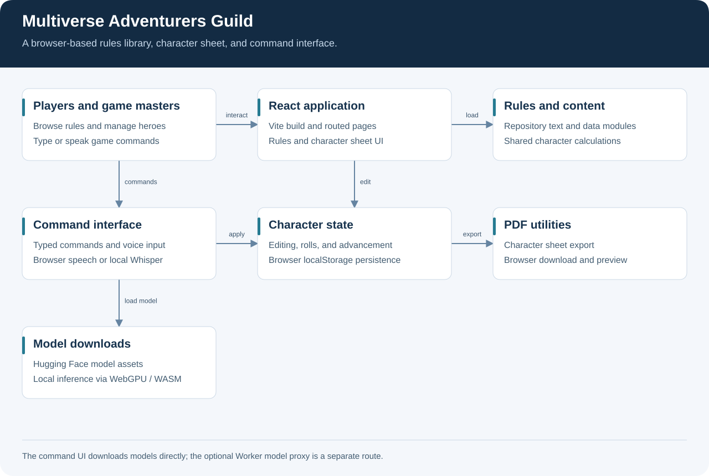

# Architecture

A browser-based rules library, character sheet, and command interface.

The command UI downloads models directly; the optional Worker model proxy is a separate route.

## Implementation references

- [src/pages/CharacterSheet.jsx](../src/pages/CharacterSheet.jsx)
- [src/components/CommandInterface.jsx](../src/components/CommandInterface.jsx)
- [src/content](../src/content)
- [src/utils/characterSheetPdf.js](../src/utils/characterSheetPdf.js)
- [worker/index.js](../worker/index.js)

## Project overview

[Portfolio project page](https://johnbieniek.com/projects/multiverse-adventurers-guild)

This diagram describes this portfolio repository. The live Guild product described on the portfolio site also has account and subscription features that are not implemented in this checkout.
